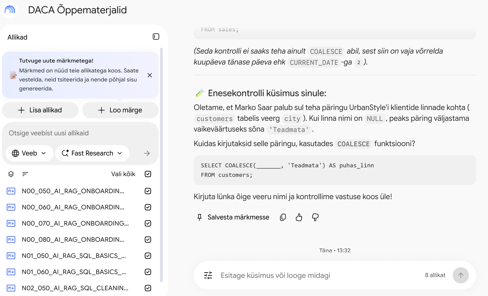
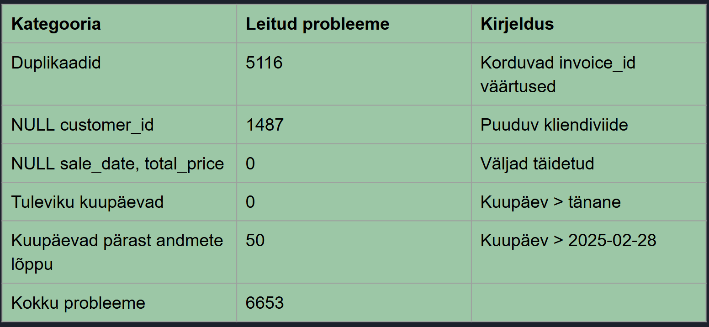

# Week 2 – SQL puhastamine

## Nädala 2 eesmärk

- Tuvastada ja eemaldada duplikaate, kasutades `GROUP BY` + `HAVING` ja `ROW_NUMBER()`
- Leida ja käsitleda NULL väärtusi, kasutades `IS NULL`, `COALESCE()` ja `NULLIF()`
- Puhastada ja ühtlustada andmevälju, kasutades `CAST`, `TRIM()`, `UPPER()`/`LOWER()` ja kuupäevafunktsioone

## Mida ma tegin?

### Individual

- NotebookLM märkmikku "DACA Õppematerjalid" lisatud 2 RAG faili juurde, kokku 8 faili ning AI tegi mulle ka teadmiste kontrolli

- Harjutused duplikaatide tuvastamisel — kuidas `GROUP BY` + `HAVING` ja `ROW_NUMBER()` aitavad leida topeltridu
- Harjutused NULL väärtuste käsitlemisel — kuidas `IS NULL`, `COALESCE` ja `NULLIF` muudavad puuduvad andmed hallatavaks
- Harjutused andmeformaatide ühtlustamisel — kuidas `TRIM`, `INITCAP` ja `TO_CHAR` tagavad, et andmed on korrektsed
- Puhastamisraport Toomasele (duplikaatide raport, NULL väärtuste raport ja formaatide diagnostika)
- Lugesin raamatut 'Storytelling with data'

### Grupitöö (Sales Analytics team)

- Roll: müügiandmete puhastaja
- Leidsin duplikaadid sales tabelist (5116), peale puhastamist jäi alles 10 118 unikaalset rida.
- Leidsin, et customer_id puudub 1487 real ehk ligi 10% müükidest on külalisostud
- Leidsin veel, et tuleviku kuupäevi ei leitud (0), kuid 50 müüki on dateeritud pärast andmete lõppu 2025-02-28. Pärast duplikaatide eemaldamist on neid 32
- Lõin test koopia, puhastasin ja dokumenteerisin kõik muudatused

## Mida ma õppisin?

- Duplikaatide tuvastamist: kuidas `GROUP BY` + `HAVING` ja `ROW_NUMBER()` aitavad leida topeltridu
- NULL väärtuste käsitlemist: kuidas `IS NULL`, `COALESCE` ja `NULLIF` muudavad puuduvad andmed hallatavaks
- Andmeformaatide ühtlustamist: kuidas `TRIM`, `INITCAP` ja `TO_CHAR` tagavad, et andmed on korrektsed
- Test koopia loomist ning kustutamist, andmeväljade puhastamist
